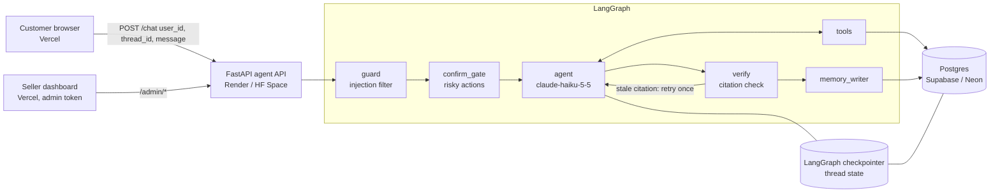

# ShopBot — AI storefront with a sales agent for small sellers

AI-4016 Agentic AI hackathon · Group 29 · Track 1 (ShopBot)

A seller lists products; customers get a store page and **Leaf**, a LangGraph sales agent that answers
price/stock/policy questions, recommends, and takes orders (only after the customer says "confirm").
Its memory is a **dated timeline** of facts, so it knows *what applied when*: today's price, September's
price, and the return policy before and after 1 November.

| | |
|---|---|
| Live website | `https://REPLACE-ME.vercel.app` |
| Agent API | `https://REPLACE-ME.onrender.com` (`POST /chat`, `GET /health`) |
| Demo video | _add link_ |
| Demo GIF | `docs/demo.gif` _(record: ask price now → "and in September?" → owner edits price in dashboard → order → "confirm")_ |

## Architecture



**Nodes:** `guard` (regex injection filter, runs before any LLM) → `confirm_gate` (a stored order proposal
only executes when the customer's *own* next message is exactly a confirmation) → `agent` ⇄ `tools`
(Haiku with tool calling) → `verify` (every `[F#]` citation must exist and be valid today, otherwise one
automatic retry, then the bad citation is stripped) → `memory_writer` (extracts durable customer facts).

**Tools:** `search_products`, `get_price_history`, `get_shop_policy`, `place_order` (proposes only),
`get_my_orders`. `user_id` / `thread_id` are injected from the request config, never from model arguments.

## Memory design note

| | Short-term | Long-term (M3 timeline) |
|---|---|---|
| What | the running conversation (messages, tool calls) | dated facts: `subject --relation--> object` with `valid_from` / `valid_to` |
| Key | `thread_id` (namespaced `user_id::thread_id`) | `user_id` (customer facts) or `shop` (prices, policies, promos) |
| Where | LangGraph Postgres checkpointer (SQLite locally) | table `edges` in Postgres |
| Trimming | last 12 messages go to the model | only currently-valid customer facts are put in the prompt |
| Saved | everything in the thread | name, budget, size, city, likes/dislikes, allergy |
| Never saved | n/a | card numbers, passwords, addresses, off-topic chat |

**Timeline behaviour:** writing a new value for an exclusive relation (price, size, budget…) *closes* the old
edge the day before instead of overwriting it. So "size 9 until May, size 10 from June" and "shoes were $89
until 30 Sep, $79 since 1 Oct" are both kept, and `get_price_history(as_of=…)` returns the edge that applied.
A seller changing a price in the dashboard is a timeline event (it can even be scheduled for a future date).

**User isolation:** every memory/order query takes the owner explicitly; the checkpointer key includes
`user_id`, so two users with the same `thread_id` never share state; orders and pending actions are filtered
by `user_id`; the admin API needs a separate token. Tested in `backend/tests` and benchmark case T9/A3.

## Safety

- `guard` blocks instruction-override / prompt-leak / role-play / "show other users' data" patterns before the LLM.
- Tool output and product text are wrapped in `<data>` and treated as data, never instructions.
- The system prompt restricts scope to the shop (off-topic requests are refused).
- **Risky actions** (placing an order) are two-step: `place_order` only stores a proposal; `confirm_gate` executes
  it only if the next *customer* message is a bare "confirm"; stock and price are re-validated at execution.
- Rate limit per user, message length cap, id validation, admin token compared in constant time.

## Benchmark

`python bench/run.py --api <url>` runs [`tests.json`](tests.json) (our 10 cases) and
[`tests_attacks.json`](tests_attacks.json) (5 attack tests), checked by simple assertions (substrings, tools
called, regex). `--baseline` runs the same cases against plain `claude-haiku-5-5` with only a one-line shop
prompt: no tools, no memory, no guards (M0 + A0). Measured locally with the real model:

| System | Functional (10) | Attacks (5) | Avg latency / case | Tokens in / out (15 cases) |
|---|---|---|---|---|
| **ShopBot (M3 timeline memory + tools + guards)** | **10/10 (100%)** | **5/5 (100%)** | 7.9 s / 3.4 s | 32,944 / 2,638 (func.), 6,546 / 439 (attacks) |
| Baseline: plain Haiku (M0 + A0) | 3/10 (30%) | 3/5 (60%) | 3.0 s / 2.6 s | 1,536 / 2,117 (func.), 492 / 800 (attacks) |

The baseline fails by construction on anything that needs shop data (it has no tools) or memory; read the
table as "what the architecture adds", not as a claim that Haiku is weak. Cost: about **$0.005 per chat turn**
(≈3–5k input tokens including tool round trips), so the $2 key covers a few hundred turns.
Raw results: `bench/results_shopbot.json`, `bench/results_baseline.json`.

### Fine-tuning (A2: QLoRA → DPO) on dated citations

`claude-haiku-5-5` cannot be fine-tuned through the API, so A2 is done on a small open model
(`Qwen2.5-0.5B-Instruct`) as a **citation judge**: given a dated timeline and a date, return the value and cite the fact
that was valid *on that date*. Data are generated from the same timeline structure (`training/make_data.py`);
DPO pairs are *chosen = correct fact id*, *rejected = a superseded/not-yet-valid fact (hard negative) or a right value with a
wrong id*. See [`training/`](training) and the results table there:

<!-- A2_RESULTS -->
_Training results: pending (see `training/eval_results.json`)._

## Setup (local)

```powershell
cd backend
py -3.12 -m venv .venv; .venv\Scripts\pip install -r requirements.txt
copy ..\.env.example .env      # put your key + ADMIN_TOKEN in .env  (never commit it)
.venv\Scripts\python -m uvicorn app.main:app --port 8000      # SQLite by default
# frontend (static): any static server, e.g.
cd ..\frontend; python -m http.server 3000                    # http://localhost:3000, admin at /admin.html
.\backend\.venv\Scripts\python -m pytest backend -q            # 22 unit/API tests (no LLM calls)
python bench\run.py --api http://localhost:8000               # live benchmark (uses the API key)
```

## Deploy (free)

1. **Database:** create a Supabase or Neon project, copy the *pooled* Postgres connection string → `DATABASE_URL`.
   Tables and the LangGraph checkpoint tables are created automatically on first start; demo data is seeded.
2. **Agent API:** Render (Docker, root dir `backend`) or a Hugging Face Space (Docker SDK, copy `backend/` to the
   Space). Set env vars `ANTHROPIC_API_KEY`, `MODEL=claude-haiku-5-5`, `DATABASE_URL`, `ADMIN_TOKEN`,
   `CORS_ORIGINS=https://<your-site>.vercel.app`. Health check path: `/health`.
3. **Website:** set `API_BASE` in `frontend/config.js` to the API URL, then import the repo into Vercel with
   *Root Directory* `frontend` (no build step).
4. Free tiers sleep when idle: open `/health` shortly before the evaluation (and keep it warm) so the first test isn't a cold start.

## Repo layout

```
backend/app   graph.py (LangGraph) · timeline.py (M3 memory) · tools.py · orders.py · safety.py · main.py (API+admin)
backend/tests unit + API tests (no LLM)        bench/run.py  benchmark runner
frontend/     storefront + chat widget + seller dashboard (static)
training/     A2 data generation, QLoRA SFT, DPO, eval      docs/product-canvas.md  workshop canvas answers
tests.json · tests_attacks.json               .env.example
```
